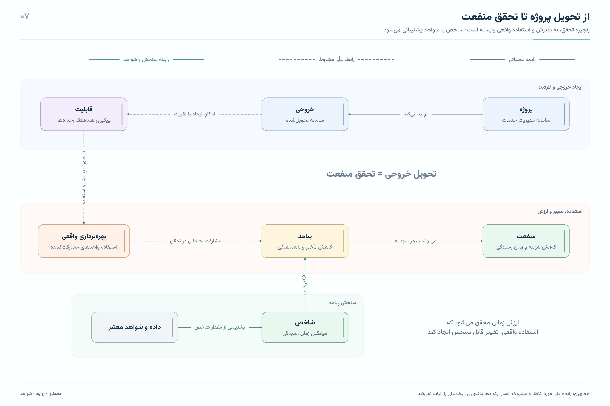

# نمودارهای نظام یکپارچه مدیریت سازمان

۱۷ تصویر با فونت **وزیرمتن**: ۱۲ نمودار اصلی و ۵ تصویر تکمیلی، با رنگ‌های روشن، چیدمان معنایی، و برچسب‌های رابطه بدون کادر.

## دریافت فایل‌ها

- [دانلود مجموعه کامل تصاویر PNG و فایل‌های برداری SVG — ZIP، حدود ۹ مگابایت](deliverables/organization-diagrams.zip?raw=true)
- [مشاهده و دریافت PDF کامل، ۱۷ صفحه](deliverables/organization-diagrams.pdf)
- [مرور پوشه تصاویر و فایل‌های مستقل](deliverables/diagrams)

پس از بازکردن ZIP، فایل `index.html` را در مرورگر باز کنید تا تمام تصاویر را ببینید و هرکدام را جداگانه دریافت کنید.

## نمونه تصویر

## تصاویر جداگانه

| شماره | عنوان | تصویر | برداری | PDF |
|---|---|---|---|---|
| 1 | نقشه کلان نظام یکپارچه مدیریت سازمان | [PNG](deliverables/diagrams/01.png) | [SVG](deliverables/diagrams/01.svg) | [PDF](deliverables/diagrams/01.pdf) |
| 2 | مأموریت، هدف و قابلیت سازمانی | [PNG](deliverables/diagrams/02.png) | [SVG](deliverables/diagrams/02.svg) | [PDF](deliverables/diagrams/02.pdf) |
| 3 | هم‌راستایی اهداف در چند سازمان | [PNG](deliverables/diagrams/03.png) | [SVG](deliverables/diagrams/03.svg) | [PDF](deliverables/diagrams/03.pdf) |
| 4 | ساختار اجرایی یک برنامه مشترک | [PNG](deliverables/diagrams/04.png) | [SVG](deliverables/diagrams/04.svg) | [PDF](deliverables/diagrams/04.pdf) |
| 5 | یک طرح، چند دوره برنامه‌ریزی | [PNG](deliverables/diagrams/05.png) | [SVG](deliverables/diagrams/05.svg) | [PDF](deliverables/diagrams/05.pdf) |
| 6 | پروژه پایان می‌یابد؛ فرایند تکرار می‌شود | [PNG](deliverables/diagrams/06.png) | [SVG](deliverables/diagrams/06.svg) | [PDF](deliverables/diagrams/06.pdf) |
| 7 | از تحویل پروژه تا تحقق منفعت | [PNG](deliverables/diagrams/07.png) | [SVG](deliverables/diagrams/07.svg) | [PDF](deliverables/diagrams/07.pdf) |
| 8 | حاکمیت برنامه بین‌سازمانی | [PNG](deliverables/diagrams/08.png) | [SVG](deliverables/diagrams/08.svg) | [PDF](deliverables/diagrams/08.pdf) |
| 9 | چرخه عمر یک برنامه | [PNG](deliverables/diagrams/09.png) | [SVG](deliverables/diagrams/09.svg) | [PDF](deliverables/diagrams/09.pdf) |
| 10 | مدل یکپارچه؛ از هدف تا تحقق منفعت | [PNG](deliverables/diagrams/10.png) | [SVG](deliverables/diagrams/10.svg) | [PDF](deliverables/diagrams/10.pdf) |
| 11 | پنج گروه اطلاعات در مدل منطقی مشترک | [PNG](deliverables/diagrams/11.png) | [SVG](deliverables/diagrams/11.svg) | [PDF](deliverables/diagrams/11.pdf) |
| 12 | ساختار فعلی؛ برنامه، گام و فعالیت | [PNG](deliverables/diagrams/12.png) | [SVG](deliverables/diagrams/12.svg) | [PDF](deliverables/diagrams/12.pdf) |
| 13 | دو منطق متفاوت: عضویت مدیریتی و تحقق نتیجه | [PNG](deliverables/diagrams/13.png) | [SVG](deliverables/diagrams/13.svg) | [PDF](deliverables/diagrams/13.pdf) |
| 14 | از کنترل فعالیت‌ها تا مدیریت نتیجه | [PNG](deliverables/diagrams/14.png) | [SVG](deliverables/diagrams/14.svg) | [PDF](deliverables/diagrams/14.pdf) |
| 15 | شاخص: پوشش خدمات استاندارد | [PNG](deliverables/diagrams/15.png) | [SVG](deliverables/diagrams/15.svg) | [PDF](deliverables/diagrams/15.pdf) |
| 16 | دامنه پیشنهادی نمونه‌سازی | [PNG](deliverables/diagrams/16.png) | [SVG](deliverables/diagrams/16.svg) | [PDF](deliverables/diagrams/16.pdf) |
| 17 | چهار قابلیت بنیادین نظام جدید | [PNG](deliverables/diagrams/17.png) | [SVG](deliverables/diagrams/17.svg) | [PDF](deliverables/diagrams/17.pdf) |

## درباره بازطراحی

اتصال‌های نمودارها در متن کپی‌شده حفظ نشده بود. جهت رابطه‌ها بر پایه توضیحات، جدول‌ها و مثال‌های همان متن بازسازی و بازبینی شده است. متن مسیرهای عمودی چرخیده و روابط علّی مشروط با خط‌چین مشخص شده‌اند. جزئیات در [راهنمای مجموعه](deliverables/diagrams/راهنما.txt) آمده است.

تصاویر PNG بین ۴۰۰۰ و ۵۰۰۰ پیکسل عرض دارند. فایل‌های SVG و PDF برداری‌اند. فونت وزیرمتن و مجوز OFL در پوشه `deliverables/diagrams/fonts` موجود است.
